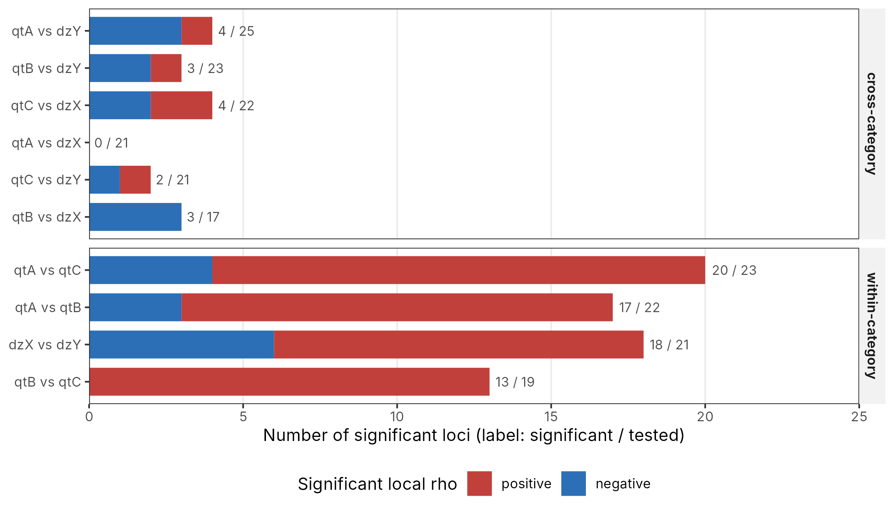
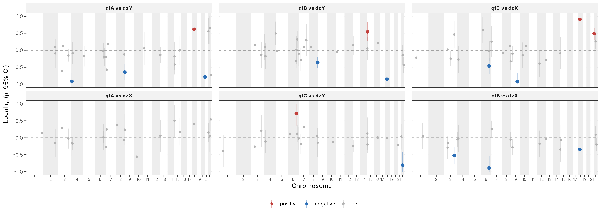
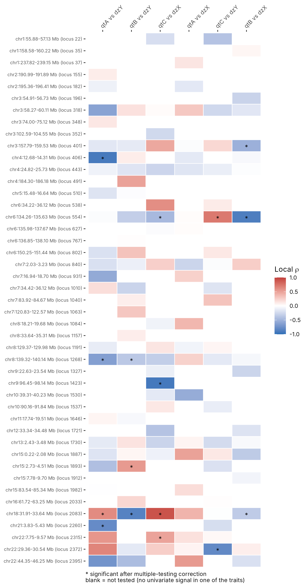
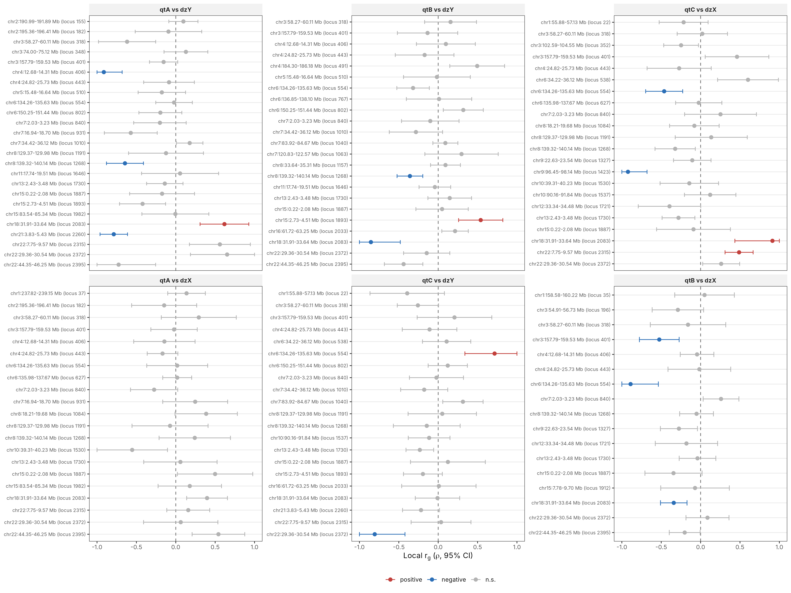
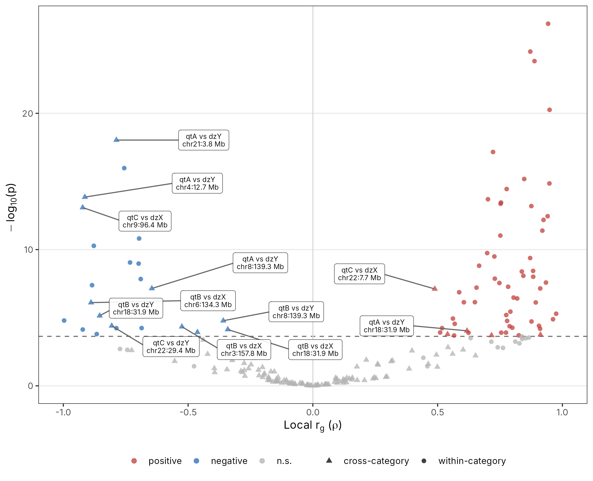

# Plotting LAVA bivariate local genetic correlations in R

A single R script that turns the bivariate output of
[LAVA](https://github.com/josefin-werme/LAVA) (local analysis of [co]variant association)
into a standard set of figures and tidy tables:

| Figure | What it shows |
|---|---|
| `01_pair_counts` | how many loci are significant for each trait pair, split by sign |
| `02_genome_*` | local *r*<sub>g</sub> (ρ) with 95 % CI for every tested locus along the genome, one panel per pair |
| `03_heatmap_*` | locus × pair heatmap of ρ, starred where significant |
| `04_forest_*` | ρ with 95 % CI per locus, one panel per pair |
| `05_volcano` | ρ against −log<sub>10</sub>(*p*) for every test, strongest hits labelled |

The script is written for any set of traits. It needs no editing to run; two
optional lines at the top tell it which traits belong to the same category, so
that the cross-category pairs (usually the ones you care about) get their own
figures.

Everything below was produced from `example/example.bivar.lava`, a **simulated**
file with three quantitative traits (`qtA`, `qtB`, `qtC`) and two binary traits
(`dzX`, `dzY`). It has the same format as real LAVA output but no biological
meaning.

---

## 1. What LAVA bivariate output looks like

`run.bivar()` (or the LAVA tutorial's analysis script) writes one row per locus
per trait pair, typically with a `.bivar.lava` extension:

```
locus  chr  start     stop      n_snps  n_pcs  phen1  phen2  rho       rho.lower  rho.upper  r2        r2.lower  r2.upper  p
1568   1    3496192   4197637   903     56     qtA    dzX    -0.229722 -0.61221   0.15277    0.052772  0         0.3748    0.239126
1568   1    3496192   4197637   903     56     qtA    dzY    0.602621  0.36744    0.8378     0.363152  0.13501   0.70191   5.10577e-07
```

- `locus`, `chr`, `start`, `stop` — the locus from the locus file you gave LAVA
- `phen1`, `phen2` — the two phenotypes being correlated
- `rho`, `rho.lower`, `rho.upper` — local genetic correlation and its 95 % CI (bounded to [−1, 1])
- `r2`, `r2.lower`, `r2.upper` — the squared correlation (proportion of local genetic signal shared)
- `p` — *p*-value for ρ ≠ 0

Two things to keep in mind when reading these files:

1. **Not every pair is tested at every locus.** In the usual workflow a
   bivariate test is only run where *both* traits show univariate local
   heritability (e.g. univariate *p* < 1 × 10⁻⁴). A pair that is missing at a
   locus was never tested there; it is not a null result.
2. **The number of tests differs by pair**, so "number of significant loci" only
   means something next to "number of loci tested". The figures show both.

## 2. Requirements

- R ≥ 4.1
- packages: `dplyr`, `tidyr`, `ggplot2`, `scales`, `ggrepel`

```r
install.packages(c("dplyr", "tidyr", "ggplot2", "scales", "ggrepel"))
```

Tested with R 4.3, ggplot2 3.4 and ggrepel 0.9.

## 3. Quick start

From the command line:

```bash
Rscript plot_lava_bivar.R example/example.bivar.lava example/output
```

The second argument is the output directory (default `lava_plots`). On a file
with a few hundred tests this takes about ten seconds and prints one line:

```
Read 214 bivariate tests over 55 loci and 10 trait pairs; 84 significant (bonferroni, alpha = 0.05, p < 0.000234).
Written to .../example/output
```

From RStudio or an R session, `source()` the script to load the functions
without running anything, then either run the whole thing or call the plot
functions one by one:

```r
source("plot_lava_bivar.R")

# everything, same as the command line
res <- run_all("example/example.bivar.lava", "example/output")

# or piece by piece
lava <- tidy_lava("example/example.bivar.lava")
plot_genome(lava, pairs = c("qtA vs dzY", "qtB vs dzY"), ncol = 1)
plot_forest(lava, pairs = "qtA vs dzY", sig_only = TRUE)
plot_heatmap(lava, loci_sig_only = TRUE)
```

Every `plot_*()` function returns a ggplot object, so you can add layers,
change the theme, or `ggsave()` it at whatever size you need.

## 4. What is written

```
example/output/
├── lava_bivar_tidy.tsv              input + pair label, pair type, adjusted p, significance flag
├── summary_per_pair.tsv             n tested / n significant / n positive / n negative / min p, per pair
├── significant_cross_category.tsv   significant cross-category rows, sorted by p
├── 01_pair_counts.{png,pdf}
├── 02_genome_cross.{png,pdf}        cross-category pairs only
├── 02_genome_all.pdf                every pair (can be tall)
├── 03_heatmap_cross.{png,pdf}       cross-category pairs, all loci tested in them
├── 03_heatmap_all.pdf               every pair, loci significant in at least one pair
├── 04_forest_cross.{png,pdf}
└── 05_volcano.{png,pdf}
```

The "cross" figures only appear if the trait-category mapping (section 6)
produces at least one cross-category pair.

## 5. Reading the figures

### 5.1 Significant loci per pair



One bar per trait pair, split into positive (red) and negative (blue) local
correlations that pass the multiple-testing threshold. The label is
*significant / tested*. Pairs are grouped into cross-category and
within-category panels and sorted by number of tests.

This is the figure to look at first: it tells you how much signal there is at
all, and whether it is one-directional (e.g. two closely related traits that
are positively correlated almost everywhere) or mixed.

### 5.2 Genome-wide local *r*<sub>g</sub>



Each panel is one trait pair. Every tested locus is a point at its genomic
midpoint, with its 95 % CI as a vertical bar; the dashed line is ρ = 0.
Significant loci are larger and coloured by sign, non-significant ones are
grey. Chromosome bands alternate white and grey.

Use it to see *where* the shared signal sits — whether it clusters in a few
regions or is spread across the genome — and to spot loci where the sign flips
between pairs.

### 5.3 Locus × pair heatmap



Rows are loci in genomic order, columns are trait pairs, colour is ρ, and a
star marks a significant test. **Blank cells are loci that were not tested for
that pair** (no univariate signal in one of the two traits), which is different
from a white cell with ρ ≈ 0.

This is the most compact overview of the results and the easiest way to find a
locus that is correlated with several traits at once.

### 5.4 Forest plots



ρ with its 95 % CI for each locus, one panel per pair, loci in genomic order.
Useful when you want to show the uncertainty honestly: many local correlations
are estimated at ρ = ±1 with a wide interval, and the forest plot makes that
visible where a heatmap hides it.

### 5.5 Volcano



Every test in one picture: ρ on the x-axis, −log<sub>10</sub>(*p*) on the
y-axis, the dashed line is the significance threshold. Triangles are
cross-category pairs, circles within-category. The strongest cross-category
hits are labelled with pair and locus.

LAVA reports *p* = 0 for very strong correlations; those are capped
(`neglog10_cap`, default 50) so the axis stays readable, and the axis label
says so when it happens.

## 6. Settings

All settings are in the block at the top of the script.

```r
alpha        <- 0.05
p_adjust     <- "bonferroni"   # or "BH"
genome_build <- "hg19"         # or "hg38"
neglog10_cap <- 50

trait_group    <- function(x) sub("_.*$", "", x)
group_category <- c(qtA = "quantitative", qtB = "quantitative", qtC = "quantitative",
                    dzX = "disease",      dzY = "disease")
```

**Multiple testing.** By default a test is significant if
*p* < `alpha` / (number of bivariate tests in the file), which is the correction
the LAVA authors recommend. Set `p_adjust <- "BH"` for a false-discovery-rate
threshold instead. The adjusted *p* is written to `lava_bivar_tidy.tsv` either
way.

**Genome build.** Chromosome lengths are used to lay loci out along the x-axis
of the genome plots. LAVA's supplied locus file (2,495 blocks) is GRCh37/hg19;
if you built loci on GRCh38, set `genome_build <- "hg38"`.

**Trait groups and categories.** This only affects which pairs are called
"cross-category" and get their own figures; every pair is always included in
the `*_all` outputs. It works in two steps:

1. `trait_group()` reduces a phenotype name to a group. The default strips
   everything from the first underscore, so `height_male` and `height_female`
   both become `height`. If your names have no suffix, it does nothing.
2. `group_category` maps each group to a category. Groups that are not listed
   become their own category. Set it to `NULL` to make every group its own
   category, in which case every pair of different traits is "cross-category".

Some examples:

```r
# sex-stratified GWAS of three biomarkers vs two diseases:
#   ALB_male, ALB_female, CRP_male, ..., DIS1_male, DIS1_female, ...
trait_group    <- function(x) sub("_(male|female)$", "", x)
group_category <- c(ALB = "biomarker", CRP = "biomarker", DIS1 = "disease", DIS2 = "disease")

# plain trait names, two categories
trait_group    <- function(x) x
group_category <- c(bmi = "anthropometric", whr = "anthropometric",
                    t2d = "disease", cad = "disease")

# no categories at all
group_category <- NULL
```

**Colours** are set in `cls_cols` (positive / negative / not significant).

## 7. Function reference

| Function | Arguments | Notes |
|---|---|---|
| `tidy_lava(infile, build)` | path to `.bivar.lava` | returns a tibble with `pair`, `pair_type`, `locus_label`, `p_adj`, `sig`, `class` and genome coordinates; the Bonferroni threshold is stored as `attr(x, "p_thresh")` |
| `summarise_pairs(dat)` | | per-pair counts |
| `plot_pair_counts(dat)` | | |
| `plot_genome(dat, pairs, ncol, show_ci)` | `pairs` = character vector of `"A vs B"` labels | |
| `plot_heatmap(dat, pairs, loci_sig_only)` | `loci_sig_only = TRUE` keeps loci significant in ≥ 1 of the chosen pairs | |
| `plot_forest(dat, pairs, sig_only, ncol)` | | |
| `plot_volcano(dat, label_n, label_cross_only)` | | |
| `run_all(infile, outdir, build)` | | writes everything listed in section 4 and returns `list(data, summary)` |

Pair labels are always `phen1 vs phen2` in the order LAVA wrote them; run
`levels(lava$pair)` to see them.

## 8. Things to keep in mind

- **A local ρ of exactly ±1 with a CI reaching the boundary** is common and
  usually means the local signal is small and the estimate is poorly
  constrained, not that the two traits are genetically identical there. Look at
  the CI (forest plot) and at the univariate local *h*² before interpreting it.
- **Regions of extended LD** (the MHC on chromosome 6, the 17q21.31 inversion,
  the 8p23.1 inversion and similar) often produce very strong local
  correlations across many trait pairs. Flag them rather than over-interpret
  them.
- **Loci are not independent tests of the same hypothesis.** Adjacent LAVA
  blocks can carry the same signal, so counting significant loci is a rough
  summary, not an effect size.
- **Sign is relative to how each trait was coded** in the GWAS you supplied to
  LAVA.
- Columns `n_pcs`, `r2.lower` and `r2.upper` are carried through to the tidy
  table but not plotted.

## 9. Citing LAVA

If you use these plots in a paper, cite the method:

Werme J, van der Sluis S, Posthuma D, de Leeuw CA. An integrated framework for
local genetic correlation analysis. *Nature Genetics* 2022;54:274–282.
https://doi.org/10.1038/s41588-022-01017-y

## License

MIT. Use it, change it, no attribution needed beyond the LAVA citation above.
